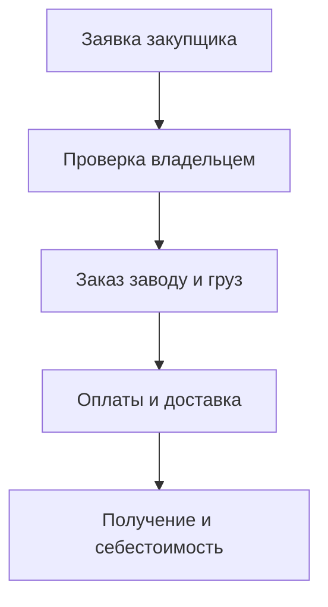
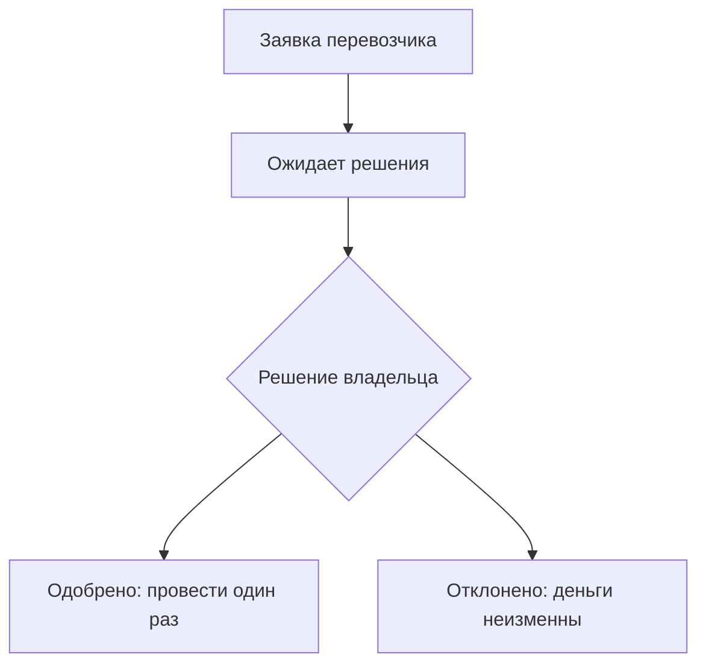
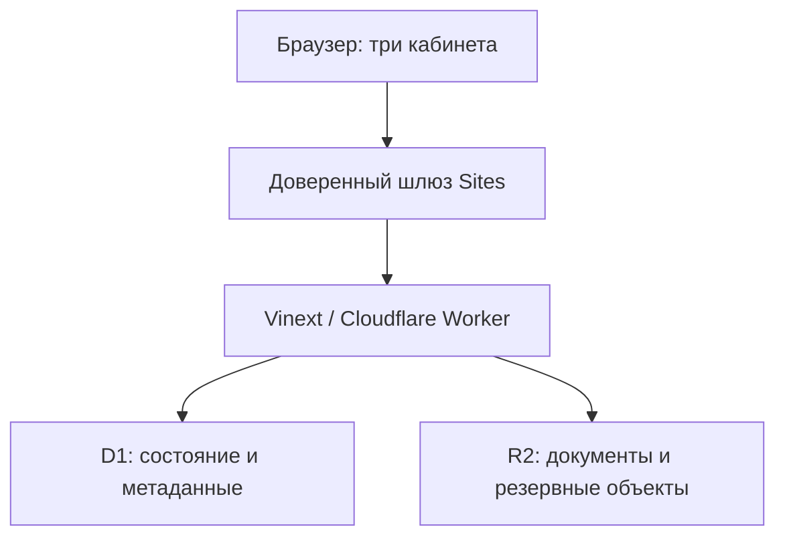

# Мои закупки — Китай / calc

Техническое задание, описание действующей системы и архитектура её дальнейшего развития.

**Назначение:** единое рабочее место владельца бизнеса, закупщика и перевозчика для закупок в Китае: от предварительной заявки до получения груза и расчёта себестоимости каждой позиции в тенге.

| Параметр | Значение |
| --- | --- |
| Репозиторий | https://github.com/ruslanilin1110-cell/calc |
| Действующее приложение | https://china-ledger.bubblystork1.chatgpt.site |
| Срез документации | 23 октября 2026 года |
| Исходная опубликованная версия | Sites 53 |
| Исходный commit в репозитории Sites | `3879a86cbdf7122d4eb702ec2c60c4a5976c2ae6` |
| Статус поставки | Исходный код действующего приложения, SQL-миграции, тесты, конфигурация и эксплуатационные скрипты |
| Язык интерфейса / основная валюта учёта | Русский / KZT |
| Валюты операций | KZT, CNY, USD |

## 1. Как читать документацию

- **Этот файл** — требования, текущая архитектура, правила расчётов и критерии работы платформы.
- **[plan.md](plan.md)** — подробный план развития, зависимости, контрольные точки и приёмка каждого этапа.
- **[agent.md](agent.md)** — инструкция для разработчика и AI-агента: карта модулей, инварианты, порядок изменений и проверок.
- **[AGENTS.md](AGENTS.md)** — точка входа для инструментов, которые автоматически читают инструкции репозитория.
- **[docs/sites-starter.md](docs/sites-starter.md)** — сохранённая документация исходного runtime/starter: особенности локального запуска и ChatGPT Sites.
- **[docs/source-manifest.json](docs/source-manifest.json)** — контрольные суммы перенесённых исходных файлов.

Обозначения: **реализовано** означает наличие логики в этом срезе кода; **целевое требование** означает работу из `plan.md`, а не обещание уже существующей функции. Наличие сторонней библиотеки в `package.json` само по себе не означает наличие соответствующей функции продукта.

## 2. Бизнес-процесс

1. Закупщик собирает заявку вручную или импортирует Excel/PDF со списком товаров.
2. Для каждой позиции указывает количество, единицу и срочность; при необходимости уточняет предварительную калькуляцию.
3. Отправляет заявку администратору. Заявка сохраняется отдельно от грузов и финансовых операций.
4. Администратор видит её на главной в блоке **«Нужно заказать»**, проверяет и редактирует состав.
5. Скачивает Excel и самостоятельно передаёт поставщику для подготовки накладной.
6. После согласования с заводом администратор создаёт/уточняет груз: поставщик, название, валюта, сумма заказа, товары, вес, сроки.
7. Администратор назначает перевозчику кошелёк и доступные грузы.
8. Перевозчик может конвертировать деньги своего кошелька сразу. Оплаты товара, доставки и прочих расходов сначала отправляются администратору на подтверждение.
9. После одобрения оплата изменяет финансовый учёт. До одобрения остатки кошелька и долг поставщику не меняются.
10. Участники отслеживают статус, документы и обсуждение конкретного груза.
11. Калькулятор распределяет доставку по весу, прочие расходы по стоимости и показывает полную себестоимость груза, позиции и единицы.
12. Итоговые цены используются для переноса в «МойСклад»; прямой синхронизации с его API в текущем коде нет.



Это управленческий учёт закупок. Он не заменяет банковский перевод, бухгалтерскую систему или таможенную декларацию. Кнопка записи оплаты фиксирует операцию в платформе, а не отправляет деньги через банк.

## 3. Роли и доступ

### 3.1. Матрица прав действующей версии

| Возможность | Администратор | Перевозчик | Закупщик |
| --- | --- | --- | --- |
| Просмотр грузов | Все собственные грузы | Только назначенные | Все грузы владельца |
| Создание груза | Да | Да, через ограниченный API | Нет; создаёт предварительную заявку |
| Правка названия, поставщика и суммы существующего груза | Да, карандаш у названия | Нет | Нет |
| Изменение статуса груза | Да | Назначенного груза, без подтверждения | Просмотр |
| Изменение заказа поставщику: строки, цены, количество, вес | Да | Только просмотр | Только просмотр существующего груза |
| Создание предварительной заявки | Да через редактирование/управление заявками; основной автор — закупщик | Нет | Да |
| Изменение заявки закупщика | Любой своей организации | Нет | Только своей, пока она `new` |
| Справочник срочности заявок | Добавление, правка, цвет, мягкое удаление | Нет | Выбор доступных значений |
| Кошельки, остатки и движения | Все кошельки владельца | Свой назначенный кошелёк | Недоступны, включая JSON-ответы API |
| Конвертация кошелька | Да | Свой кошелёк, сразу | Нет |
| Оплаты товара, доставки, прочих расходов | Проведение непосредственно | Только заявка на подтверждение | Нет |
| «Оплатил сам» / собственные средства | Да | Нет | Нет |
| Подтверждение/отклонение оплаты | Да | Нет | Нет |
| Калькулятор существующего груза | Да | Настройки доставки; исходные товары не меняет | Локальный пробный расчёт без записи в груз владельца |
| Калькулятор предварительной заявки | При редактировании | Нет | Да |
| Документы груза | Загрузка, просмотр, скачивание, удаление | Текущий API вложений не предоставляет доступ | Просмотр и скачивание, без изменения |
| Чат груза | Чтение и ответы | Чтение и ответы по назначенным грузам | Отправка запрещена; отдельного интерфейса чата нет |
| Скачивание заявки Excel | Все заявки владельца | Нет | Свои заявки |
| Доступы сотрудников / журнал решений | Да | Нет | Нет |
| «Посмотреть как…» | Просмотр и отдельная тестовая копия | Нет | Нет |

Не расширять права перевозчика или закупщика неявно. Например, наличие кнопки калькулятора не должно давать право менять финансовый учёт или редактировать исходный заказ.

### 3.2. Два уровня доступа

1. **Доступ к самому сайту** задаётся в ChatGPT Sites. Добавление сотрудника в приложении не заменяет выдачу доступа на уровне хостинга.
2. **Прикладной доступ** хранится в `ledger_members`: роль, активность, привязанный пользователь, кошелёк и назначенные грузы.

При первом входе приглашение по email привязывается к доверенному `user_id`. Замена email не должна передавать старые заявки новому человеку: прежний участник отключается, история сохраняется.

Авторизация выполняется на сервере при каждом запросе. Прятать кнопки недостаточно. Для закупщика `buyerLedger()` формирует разрешённый срез: грузы и связанные расходы для калькуляции, без кошельков, переводов, резервных копий, чужих заявок и идентификаторов кошельков.

### 3.3. Целевое развитие авторизации

- Явные организации (`tenant`) и членство; отсутствие записи участника не должно автоматически давать административную роль при независимом развёртывании.
- Приглашение с ограниченным сроком, отзыв сессий, история доступа, явная передача владения.
- Проверяемый сервером провайдер идентификации. Доверенные заголовки Sites допустимы только за доверенным шлюзом, который удаляет подставленные клиентом заголовки.
- Отдельные политики на роль, организацию, конкретный груз, файл, заявку и кошелёк.

## 4. Функциональное ТЗ

### F-01. Кабинет администратора

**Реализовано:** обзор кошельков; выбор видимых/свёрнутых кошельков; карточки последних грузов; поиск и фильтры; история операций; справочник поставщиков; доступы участников; подтверждение оплат; уведомления о закупках.

На главной перед кошельками отображается **«Нужно заказать»**: заявки `new` и `reviewed`, которые ещё не отмечены `ordered`. В блоке можно раскрыть состав, исправить количество/срочность/примечание, сохранить и скачать актуальный Excel. Ссылка скачивания не предлагается из несохранённого редактора как будто изменения уже записаны.

**Приёмка:** отправленная закупщиком заявка появляется у владельца, редактирование сохраняется, следующий экспорт содержит сохранённую версию. Чужие организации не видны.

### F-02. Кошельки и карточки фирм

- Несколько независимых кошельков для закупщиков-посредников/перевозчиков/брокеров.
- Карточка фирмы с контактными и справочными данными.
- Остатки KZT/CNY/USD, стоимость валюты в KZT, история движений.
- Начальные остатки, передача денег, конвертация, оплата, возврат поставщика и возврат денег от фирмы.
- Возможность сворачивать кошельки и выбирать, какие показывать на главной.
- Возврат от фирмы уменьшает её остаток; не является расходом на конкретный груз сам по себе.

**Инвариант:** операция одного кошелька не изменяет остатки другого. Поздний новый обмен не переписывает стоимость ранее проведённой оплаты.

### F-03. Собственные средства администратора

В оплате товара, доставки и прочих расходов администратор выбирает источник: кошелёк или **«Оплатил сам»**. Личная оплата включается в расходы груза, но не списывает деньги из кошелька посредника. Перевозчику и закупщику источник `personal` запрещён сервером.

### F-04. Поставщики

Создание, поиск, контакты, архивирование, восстановление, мягкое удаление. Исторические грузы сохраняют связь и наименование поставщика. Одинаковые названия нормализуются при проверке дублей. Архив/удаление не должны терять историю финансовых операций.

### F-05. Карточка груза

Поля: поставщик; название; валюта и полная сумма заказа; количество/единица; даты заказа, ожидания и получения; номер/трек; статус; заметки; товары; настройки калькулятора.

- Карандаш около названия открывает полную правку исходных реквизитов у администратора.
- Ручное изменение суммы заказа сохраняет `orderTotalMode: manual`, чтобы дальнейшее сохранение строк не затирало поправку.
- В шапке справа — заметный цветной статус. Короткий список статусов и отдельное управление добавлением, изменением и удалением.
- Компактные блоки: стоимость, оплачено, остаток, товар/доставка/прочее в KZT.
- Кнопки: «Оплатить товар», «Доставка», «Прочие расходы», «Калькулятор» — только в пределах роли.
- «Заказ поставщику» раскрывает компактную таблицу строк; загрузка файла расположена рядом.
- Документы и чат относятся к конкретному грузу.
- Удаление груза блокируется при проведённых операциях или ожидающих оплатах; нельзя скрытно откатывать деньги удалением карточки.

### F-06. Строки товаров

Поля: UUID, наименование, количество, единица, цена за единицу в валюте заказа, вес, единица веса (`g`/`kg`), способ задания веса (`unit`/`total`). Цена и вес могут быть не заполнены во время подготовки; полный расчёт должен объяснять, чего не хватает.

Строки добавляются, редактируются и удаляются. Кнопка удаления компактная, с иконкой корзины. Сохранение использует `productsRevision`; при конфликте нельзя затереть чужую правку.

### F-07. Импорт Excel/PDF

- `.xls`/`.xlsx` из «МоегоСклада»: поиск заголовков после служебных строк; наименования, количество, единицы; цена и валюта, если присутствуют.
- Итоги, пустые строки, пояснения и повторные заголовки не становятся товарами.
- Предпросмотр листа; удаление отдельных импортируемых строк; добавление к текущим либо замена.
- В заявке закупщика действие подписано **«Сохранить и редактировать»** и переносит строки в редактируемую таблицу. Отправка заявки администратору — отдельное действие.
- Excel читается в Web Worker. Текстовые PDF разбираются PDF.js с учётом расположения строк/колонок.
- Сканированный PDF без текста не распознаётся автоматически: OCR — отдельная будущая функция. Такой файл можно прикрепить как документ.

Текущие пределы: импорт до 5 МБ, до 100 позиций; PDF до 30 страниц и 50 000 текстовых элементов; таймауты чтения Excel/PDF 15/30 секунд. Это ограничения приложения, а не гарантии точности произвольной накладной.

### F-08. Назначения платежей и этапы доставки

Независимые справочники для оплаты товара (`payment`), доставки (`shipping`) и прочих расходов (`fee`). Администратор создаёт, переименовывает и удаляет назначения. Изменение раздела «Доставка» не затрагивает назначения оплаты товара.

Перевозчик выбирает назначения владельца, но не редактирует их. Исторические записи сохраняют смысл после мягкого удаления значения. Этапы доставки могут включать внутреннюю доставку по Китаю, Китай → Хоргос, Китай → Алматы, Алматы → Астана; названия настраиваются, а не зашиваются в расчёты.

### F-09. Оплаты с конвертацией

В операции различаются:

1. Валюта и сумма списания с выбранного источника.
2. Стоимость списания в KZT для учёта.
3. Валюта и сумма, зачтённые в оплату заказа поставщика.

Например: отдано 1 000 000 KZT, заказ в CNY, курс 71 KZT/CNY. Поставщику засчитывается примерно 14 084,51 CNY с предусмотренным округлением. Сумму в CNY нельзя вычислять как KZT без курса или дважды применять курс.

Оплата может быть частичной и несколькими траншами. Долг считается в валюте заказа; стоимость оплаченного товара в KZT складывается из фактических стоимостей проведённых траншей с учётом возвратов.

### F-10. Подтверждение оплат перевозчика



- Статусы: `pending`, `approved`, `rejected`.
- До одобрения финансовая операция отсутствует в журнале проведённых операций.
- При подтверждении повторно проверить активность участника, назначение груза/кошелька, валюту заказа, доступность средств и ревизию данных.
- Запись операции, решение и аудит выполняются согласованно в D1 batch с условными обновлениями.
- Повторная отправка с тем же UUID не должна создавать второй расход.
- Две конкурирующие заявки не должны дважды потратить один остаток.
- Отклонение требует причины, которая видна автору.
- Отзыв доступа между чтением и commit блокирует проведение.

### F-11. Конвертация кошелька

Перевозчик может менять валюты своего кошелька без подтверждения администратора. В одной записи списывается одна валюта и зачисляется другая, сохраняются суммы и курс. Балансы других кошельков и долг по грузу не меняются.

Текущий helper `exchangeReceived()` использует историческое соглашение интерфейса: при зачислении KZT умножение, при зачислении иной валюты деление. Для поддерживаемых направлений всегда ориентироваться на подпись единицы курса в UI. **Целевое требование:** заменить неявное направление явными `sourceCurrency`, `targetCurrency`, `quoteDirection` с совместимой миграцией, не переинтерпретируя старые записи.

### F-12. Калькулятор и полная себестоимость

Три способа доставки:

1. Тариф за килограмм × общий вес × курс в KZT.
2. Введённая общая стоимость доставки, распределённая между товарами.
3. Фактически учтённые оплаты доставки по всем этапам груза.

При смене способа, суммы, тарифа или курса **сразу** обновляются полная себестоимость, суммы позиций и цена за единицу. Показывать один понятный текущий итог. Удалённый дублирующий блок «Сохранённый расчёт по фактическим оплатам» не возвращать без нового требования.

В предварительном расчёте использовать явную пометку, что выбранная доставка — оценка, а прочие расходы взяты из проведённых операций. Изменение калькулятора не списывает деньги и не создаёт оплату.

В коде остаётся серверный `calculateFinalCargo()` для строгой фактической фиксации: получение груза, отсутствие неопределённых оплат, заполненные цены/вес, полная оплата и согласованность суммы строк с заказом. Отдельной активной кнопки такой фиксации в текущем калькуляторе нет; сохранение этого helper не означает наличия второго UI-итога.

### F-13. Кабинет закупщика и заявки

- Главная «Обзор закупок»: свои заявки к заказу; заказанные, находящиеся в пути и полученные грузы; карточки и быстрые фильтры всех используемых статусов, включая пользовательские.
- Новая заявка: название, комментарий, товары, количество, единицы, срочность.
- Ручной подбор: поиск по справочнику, выбор товара, количество, срочность; возможность ввести новый товар или пустую строку.
- Повтор той же позиции/единицы с той же срочностью увеличивает количество; другая срочность остаётся отдельной строкой.
- Справочник сейчас вычисляется из товаров грузов и доступной истории заявок. Это не отдельная мастер-база номенклатуры и не соединение с API «МоегоСклада».
- Импорт Excel/PDF сохраняется наряду с ручным вводом.
- Закупщик видит свои заявки, но все грузы владельца с ценами, товарами и разрешёнными документами.
- В существующем грузе разрешён пробный калькулятор без изменения владельческого расчёта; его настройки действуют в текущей вкладке.
- Нельзя видеть кошельки/остатки или подавать/подтверждать финансовые операции.

Статусы обработки заявки: `new` → `reviewed` → `ordered`. **Это не срочность** и не статус реального груза. Приём в работу снимает непрочитанное уведомление, но заявка продолжает отображаться «Нужно заказать», пока не отмечена заказанной.

Срочность — отдельный настраиваемый справочник. Начальные значения: «Срочно», «Обычный», «Не срочно». В строке заявки сохраняется историческое имя/цвет; удаление значения не уничтожает отправленные заявки.

### F-14. Выгрузка заявки для поставщика

Авторизованный серверный endpoint возвращает `.xlsx`: название заявки, автор, дата, состояние, комментарий, наименования, количества, единицы, срочность, известные цены/валюты/вес. Администратор скачивает любую свою заявку, закупщик — только собственную. После правки выгружается сохранённая версия. Автоматической отправки в email/WhatsApp поставщика пока нет.

### F-15. Документы и чат

Документы: метаданные в D1, содержимое в R2. Доступ проверяется при списке, открытии, скачивании и удалении. Проверяется имя и сигнатура файла, а не только расширение. До 20 МБ на вложение, до 30 вложений на груз. Разрешены Excel, PDF, распространённые форматы фото; браузерный просмотр HEIC может требовать скачивания.

Чат: отдельный тред на UUID груза, постоянная история, автор и время, смайлики, постраничная загрузка и опрос новых сообщений. Участник не выбирает произвольного автора или роль в теле запроса. Сообщение с повторным UUID не дублируется. В реальных чатах административный preview не должен отправлять пробные сообщения.

### F-16. Поиск, статусы и UX

- Поиск по названию, поставщику, номеру; период по заказу/ожиданию/получению; фильтр поставщика и статуса.
- Пользовательские статусы видны в фильтрах; не считать неизвестный статус автоматически «В пути».
- Пустой фильтр показывает понятное сообщение, а не пустой экран.
- Карточки компактны; основные суммы и статус читаются на телефоне.
- Критические действия имеют различимые названия и не маскируются под обычное сохранение.
- Черновик, подтверждение и фактическое проведение визуально различаются.

### F-17. Долгосрочные функции, которых ещё нет

Версионируемые резервные копии всех D1/R2-данных и проверенное восстановление; самостоятельная авторизация; нормализованный журнал проводок; сквозной аудит всех изменений; каталог SKU; связь «заявка → заказ → отгрузки → поступления»; фоновые задания; идемпотентная интеграция с «МоимСкладом»; наблюдаемость и эксплуатационные SLO; согласованные offline-черновики/PWA. Подробная реализация и приёмка — в `plan.md`.

## 5. Стек и среда выполнения

Версии ниже взяты из экспортированного `package.json`; точные разрешённые зависимости закрепляет `pnpm-lock.yaml`. Они не являются утверждением о последних версиях в интернете.

| Слой | Реальная технология |
| --- | --- |
| Основной язык | TypeScript 5.9.3, TSX; служебные Node ESM/CJS и Bash |
| Интерфейс | React 19.2.6, CSS, Tailwind CSS 4.2.1, Lucide; набор UI-компонентов shadcn/Radix/Base UI |
| Полностековый runtime | Vinext `1.0.0-beta.5` с App Router/RSC-совместимыми API |
| Совместимость Next | Зависимость `next 16.3.4`; production запускает Vinext Worker, а не обычный Next.js Node server |
| Сборка | Vite 8.0.13, `@vitejs/plugin-react` 6.0.2, RSC plugin |
| Сервер | Cloudflare Workers, Web `Request`/`Response`, `nodejs_compat` |
| БД | Cloudflare D1 / SQLite |
| Схемы БД / миграции | Drizzle ORM 0.45.2, drizzle-kit 0.31.10; рабочие API также используют параметризованный D1 SQL напрямую |
| Валидация доменных данных | Zod `^3.25.76` |
| Файлы | Cloudflare R2, закрытые объектные ключи, авторизованная выдача |
| Excel | `@e965/xlsx ^0.20.3`; клиентский Web Worker для чтения |
| PDF | `pdfjs-dist ^6.4.299`; worker генерируется перед dev/build |
| Авторизация | ChatGPT Sites / Sign in with ChatGPT, доверенный dispatch |
| Тесты | Node `node:test`, `assert`, `node:sqlite`, тестовые React-hook harnesses |
| Пакетный менеджер | `pnpm 11.25.0` |
| Node | `package.json`: >=22.13.0; для единого CI/тестов использовать проверенную ветку Node 24 |
| CLI | Wrangler 4.92.0 |

Vinext закреплён в beta-версии. Его обновление — отдельная техническая задача с проверкой RSC, Worker, auth, D1/R2 и полного финансового regression suite. Не подменять стек «обычным Next.js» только по наличию папки `app/`.

## 6. Действующая архитектура



### 6.1. Границы модулей

| Каталог / файл | Ответственность |
| --- | --- |
| `app/page.tsx` | Выбор кабинета по членству и роли |
| `app/chatgpt-auth.ts` | Чтение доверенной идентичности, пути входа/выхода |
| `app/ledger-app.tsx` | Рабочее место владельца, формы и основное состояние |
| `app/collaboration-ui.tsx` | Администрирование, перевозчик, решения по оплатам |
| `app/procurement-ui.tsx` | Заявки, права закупщика в UI, редакторы, главная очередь владельца |
| `app/buyer-dashboard.tsx` | Главная закупщика, статусы и переходы к грузам |
| `app/purchase-picker.tsx` | Ручной выбор номенклатуры и количества |
| `app/shipment-ui.tsx` | Общие карточки/детали груза |
| `app/delivery-calculator.tsx` | Реактивная форма расчёта и полный текущий итог |
| `app/cargo-products.tsx` | Редактор/просмотр строк заказа поставщику |
| `app/excel-import*`, `app/pdf-order-reader.ts` | Импорт и предпросмотр файлов |
| `app/shipment-chat.tsx`, `app/shipment-files.tsx` | Тред сообщений и вложения |
| `lib/ledger.ts` | Схемы, деньги, остатки, задолженности, статусы, справочники |
| `lib/collaboration.ts` | Ограниченные действия перевозчика и разрешённый snapshot |
| `lib/collaboration-server.ts` | Поиск и первичная привязка участника |
| `lib/procurement.ts` | Заявки, срочность, схемы, безопасный срез закупщика |
| `lib/purchase-catalog.ts` | Вычисляемый справочник и объединение строк |
| `lib/purchase-export.ts` | Формирование Excel для поставщика |
| `lib/delivery-calculator.ts` | Вес, доставка, распределение, полный расчёт с прочими расходами |
| `lib/cargo-cost.ts` | Продукты, ревизии, фактическая калькуляция, fingerprint |
| `app/api/` | HTTP-контракты, авторизация, D1/R2, атомарные записи |
| `db/schema.ts`, `drizzle/` | Схема и последовательные миграции |
| `build/`, `lib/connector-*`, `scripts/` | Runtime Sites/Worker, preview, сборка и инструменты |
| `tests/` | Финансовые, ролевые, файловые, импортные и UI-регрессии |

### 6.2. Хранение состояния

Основные сущности учёта пока хранятся одним валидируемым JSON-документом `Ledger` на владельца в `ledgers.data`. В нём находятся кошельки, поставщики, грузы, строки товаров, операции и справочники. Для конкуренции используется общая `revision` и отдельные ревизии некоторых сущностей.

Это не нормализованная ERP-база. Архитектура удобна для текущего масштаба, но увеличивает размер чтений/записей и вероятность конфликтов при росте числа сотрудников. Переход к отдельным таблицам должен быть поэтапным с полной сверкой денег и возможностью отката.

### 6.3. Существующие таблицы D1

| Таблица | Основные поля и назначение |
| --- | --- |
| `ledgers` | `owner` PK, `data` JSON, `revision` — агрегат управленческого учёта |
| `ledger_members` | `id`, `owner`, глобально уникальный `email`, `name`, `role`, `wallet_id`, JSON `shipment_ids`, `active`, `user_id`, `change_key`, `revision`, `created_at` |
| `payment_requests` | `id`, `owner`, `member_id`, JSON `payload`, `status`, время создания/решения, reviewer, reason, decision_key |
| `collaboration_audit` | `id`, owner, actor, action, subject, JSON detail, created_at |
| `attachments` | id, owner, shipment_id, name, mime, size, object_key, created_at |
| `shipment_messages` | seq autoincrement, UUID id, owner, shipment_id, actor_id/name/role, body, created_at; индекс треда |
| `procurement_settings` | owner PK, JSON справочника срочности, revision |
| `procurement_requests` | id, owner, member_id, author, JSON payload, change_key, status, seen_at, revision, created_at, updated_at; индекс owner/created_at |

Миграции `0000`…`0005` и Drizzle snapshots перенесены без изменения. Новая установка применяет их последовательно. На существующей БД нельзя повторно выполнять уже применённые `ALTER TABLE`.

Текущая схема не имеет полного набора внешних ключей, бухгалтерских ограничений и tenant-индексов целевой модели. Прикладные проверки и тесты необходимы; план нормализации не следует выдавать за уже выполненный.

### 6.4. Текущие HTTP API

| Endpoint | Действия |
| --- | --- |
| `GET /api/ledger` | Загрузить собственный ledger и revision; закупщику запрещено |
| `PUT /api/ledger` | Сохранить агрегат с проверкой revision и ссылок на файлы |
| `GET /api/collaboration` | Администратору: участники-перевозчики/решения/аудит; перевозчику: разрешённый snapshot и заявки |
| `POST /api/collaboration` | `submit`, `decide`, `member`, `convert`, `calculator`, `createCargo`, `cargoStatus`, `products`, `finalizeCargo`; авторизация зависит от действия |
| `GET /api/procurement` | Свои заявки закупщика или все заявки владельца, справочник срочности, участники для владельца |
| `GET /api/procurement?summary=1` | Счётчик непрочитанных заявок |
| `GET /api/procurement?view=buyer` | Владельцу — безопасный срез для preview; не выдача новой роли посетителю |
| `POST /api/procurement` | `submit`, `review`, `settings`, `member` |
| `GET /api/procurement/export?id=…` | Авторизованный экспорт сохранённой заявки XLSX |
| `GET/POST /api/attachments?shipmentId=…` | Список / загрузка вложения |
| `GET/DELETE /api/attachments/:id` | Открытие/скачивание / удаление вложения |
| `GET/POST /api/shipment-chat` | Чтение с before/after seq и отправка сообщения |
| `DELETE /api/shipments/:id` | Защищённое удаление карточки и связанных файлов/сообщений |
| `GET /api/ledger/reset` | Доступная владельцу резервная копия, если она существует |
| `POST /api/ledger/reset` | Специальный временный операторский сброс с ограничениями; не обычная пользовательская функция |

Типовые ответы: `401` нет входа, `403` нет права, `404` объект отсутствует в разрешённой области, `409` конфликт ревизии/состояния, `413` превышен размер. В текущих маршрутах часть ошибок Zod/домена возвращается `400`; унификация ошибок — этап плана.

## 7. Расчётная модель

### 7.1. Представление денег

Денежные суммы хранятся целыми числами в сотых долях валюты: `100000` означает `1000.00`. Всегда хранить валюту рядом с суммой. Количество товара и курс могут быть дробными. Пустая цена — не нулевая цена.

Вычисления не должны зависеть от локализованной строки вида «1 000,00 ₸». Парсинг пользовательского ввода и форматирование отделяются от доменных функций. Текущие пределы схем и `Number.isSafeInteger` обязательны; для расширения масштаба сначала выбрать decimal/rational-контракт.

### 7.2. Формулы распределения

Для позиции `i`:

- `q_i` — количество;
- `p_i` — цена единицы в валюте заказа;
- `w_i` — полный вес позиции в кг;
- `G_i` — стоимость товара в KZT;
- `S` — выбранная доставка в KZT;
- `F` — прочие проведённые расходы в KZT.

Вес: `weight × 0.001` для граммов; если указан вес единицы, дополнительно умножить на количество.

Доставка позиции: `S_i = S × w_i / sum(w)`.

Прочие расходы позиции: `F_i = F × G_i / sum(G)`.

Полная позиция: `C_i = G_i + S_i + F_i`.

Единица: `c_i = C_i / q_i`.

Итог груза: `C = sum(G) + S + F`.

Доли денежных сумм округляются методом наибольших остатков: взять целую часть в сотых и распределить оставшиеся сотые по убыванию дробных остатков. **Сумма строк должна точно совпадать с итогом расхода.** Показанное округление цены единицы само по себе не должно менять общий итог строки.

### 7.3. Пример для регрессии

| Параметр | A | B | Итого |
| --- | --- | --- | --- |
| Количество | 100 | 100 | 200 |
| Цена товара | 100 CNY | 200 CNY | 30 000 CNY |
| Вес единицы | 0,1 кг | 0,2 кг | 30 кг |
| Фактическая стоимость товара | Распределить по стоимости | Распределить по стоимости | 2 140 000 KZT |
| Учтённая доставка | 1 000 KZT | 2 000 KZT | 3 000 KZT |
| Прочие расходы | 300 KZT | 600 KZT | 900 KZT |
| Полная фактическая стоимость | 714 633,33 KZT | 1 429 266,67 KZT | 2 143 900 KZT |

Если выбрать 1,1 USD/кг при 500 KZT/USD, доставка становится 16 500 KZT, полный предварительный итог — **2 157 400 KZT**. Если выбрать общую доставку 10 000 KZT — **2 150 900 KZT**. Переключение не меняет ни одну проведённую оплату.

## 8. Целевая архитектура на несколько лет

### 8.1. Архитектурный подход

Развивать **модульный монолит** с чёткими доменными границами. Не вводить микросервисы и очередь ради самой очереди. Сначала отделить расчёты и политики от UI/SQL, нормализовать данные и обеспечить восстановление.

Предлагаемые модули: Identity/Tenancy, Procurement, Catalog, Suppliers, Orders, Shipments, Wallets/Ledger, Approvals, Costing, Documents, Messaging, Notifications, Integrations, Audit/Operations.

Правило зависимостей: HTTP/UI → application use case → domain → repository/storage adapter. Доменная функция не должна обращаться к браузеру, D1, `fetch` или runtime-секретам. Серверный use case отвечает за транзакцию, права и идемпотентность.

### 8.2. Целевая нормализованная модель

Это проектирование, а не описание существующих таблиц.

| Область | Предлагаемые сущности |
| --- | --- |
| Организации | tenants, users, memberships, invitations, permissions |
| Справочники | suppliers, products/SKU, units, currencies, status_definitions, payment_purposes, shipping_stages |
| Закупка | purchase_requests, purchase_request_items, purchase_request_revisions |
| Заказ | purchase_orders, purchase_order_items, order_request_links, supplier_invoices |
| Доставка | shipments, shipment_items, shipment_assignments, shipment_events, receipts |
| Деньги | wallet_accounts, journal_transactions, journal_lines, fx_quotes, payment_allocations, payment_requests |
| Себестоимость | cost_runs, cost_run_items, cost_sources, allocation_rules |
| Коммуникации | attachments, attachment_links, message_threads, messages, notifications, notification_reads |
| Интеграции | integration_accounts, external_id_mappings, sync_jobs, outbox_events, webhook_inbox |
| Управление | audit_events, idempotency_keys, export_jobs, backup_manifests |

В каждой бизнес-сущности: организация, стабильный UUID, времена, версия для конкурентного изменения, автор. В финансовых записях — неизменяемый источник, валюта, суммы и ссылка на сторно. Внешние идентификаторы систем не заменяют внутренний UUID.

### 8.3. Выбор БД

**Базовый путь:** сохранить D1/SQLite и R2, нормализовать модель, добавить необходимые индексы и пакетные/атомарные операции. Это уменьшает стоимость и сложность перехода.

**Условный путь:** PostgreSQL рассматривается при подтверждённой необходимости более сложных транзакций, большего числа параллельных организаций, ограничениям объёма/запросов D1 или требуемой аналитике. Решение оформляется ADR и нагрузочным тестом; PostgreSQL в текущем коде не используется.

### 8.4. Финансовое ядро

Целевой журнал — append-only с корректирующими/сторнирующими операциями вместо удаления проведённой истории. Оплата, FX, личные расходы, возвраты и распределение по заказам имеют отдельные типизированные команды. Для многовалютных проводок нельзя требовать наивного равенства сумм разных валют: нужны валюта учёта, правила оценки и связанная FX-операция.

Баланс восстанавливается из журнала и сверяется с проекцией. Изменение цены заказа не является проводкой. Предварительная стоимость не является фактической. Подтверждение перевозчика остаётся самостоятельным серверным переходом со всеми проверками.

### 8.5. Задания и интеграции

Когда появятся фоновые операции, использовать outbox в той же транзакционной границе, что бизнес-событие; затем доставку в поддерживаемую очередь/worker. Предусмотреть retries с backoff, idempotency key, dead-letter, ручной повтор и понятное состояние синхронизации.

Для «МоегоСклада»: сначала API-контракт и тестовый аккаунт; затем каталог, документы/себестоимость, внешний mapping и повторяемая сверка. Нельзя при каждом retry создавать новый документ или затирать ручную корректировку без политики конфликта.

## 9. Нефункциональные требования

| Область | Целевое требование и проверка |
| --- | --- |
| Надёжность денег | Нет двойного проведения; отрицание доступа не оставляет частичную запись; ежедневная сверка журнала/балансов |
| Разделение данных | Негативные тесты для каждой роли и чужой организации, включая экспорт, файлы, сообщения и фоновые задания |
| Конкуренция | Version/CAS и явные конфликты, отсутствие silent last-write-wins для финансов и заявок |
| Доступность | Начальная цель 99,5% в месяц; уточнить после измерения зависимостей и соглашения с владельцем |
| Производительность | Цель p95 обычного API до 800 мс на согласованном наборе данных; тяжёлые импорт/экспорт вынести из интерактивного пути при необходимости |
| UX | Телефон от 360 px; таблицы без ломания страницы; доступная клавиатура; различимые пустые/ошибочные/ожидающие состояния |
| Backup | Целевые RPO ≤24 ч, RTO ≤4 ч; не считать достигнутыми без независимого восстановления D1 и R2 |
| Безопасность | Серверная авторизация, trusted ingress, CSRF, лимиты, MIME/signature validation, закрытые объекты, контроль зависимостей |
| Эксплуатация | Request ID, структурные логи без секретов, метрики отказов/конфликтов/заданий, алерты с runbook |
| Миграции | Версионирование, dry-run, сверка количества/сумм, резервная копия, проверенный откат или forward-fix |
| Совместимость | Старые данные не меняют значения после обновления схемы или направления курса |

Значения SLO — предлагаемые критерии планирования, не измеренная гарантия текущего хостинга. Нагрузочный набор для первого теста: 1 организация, 100 кошельков, 1 000 грузов, 10 000 операций, 100 позиций/груз; далее отдельный тест целевой модели за пределами текущих schema caps.

## 10. Локальный запуск и проверка

### 10.1. Зависимости

Использовать Node 24 и `pnpm 11.25.0`, указанный в `packageManager`. Если установлен Corepack:

```sh
corepack enable
corepack prepare pnpm@11.25.0 --activate
pnpm install --frozen-lockfile
```

Если Corepack не поставляется с выбранной сборкой Node, установите именно указанную версию pnpm обычным способом администрирования среды. Не заменять lockfile произвольным `npm install` и не смешивать разные пакетные менеджеры.

Текущий `install:ci` вызывает Bash-скрипт управляемой среды. Для обычного клона переносимый путь — прямой `pnpm install --frozen-lockfile`; не считать существующий `install:ci` одинаково переносимым на Windows.

### 10.2. Проверки

```sh
pnpm exec tsc --noEmit
node --test tests/*.test.cjs
pnpm build
```

В момент экспорта успешно проверены **27 test-файлов**. Это не 27 отдельных бизнес-сценариев: один файл содержит много проверок, включая настоящую in-memory SQLite, гонки и ограничения прав. Browser QA проводилась отдельно на временных тестовых маршрутах; эти маршруты удалены из поставки.

Для обычного клона `scripts/execution-profile.mjs` выбирает `portable`, если нет локального profile. Сборка создаёт `dist/client` и `dist/server`, в том числе `dist/server/wrangler.json`. `scripts/copy-pdf-worker.mjs` копирует worker из закреплённого пакета в генерируемый каталог `public/pdfjs-worker/`.

### 10.3. Локальная D1

После первой сборки применить к **новой локальной** базе все SQL из `drizzle/` в порядке имён. Пример для одной ещё не применённой миграции:

```sh
node --import ./scripts/sites-env.mjs ./node_modules/wrangler/bin/wrangler.js d1 execute DB --local --config dist/server/wrangler.json --persist-to .wrangler/state --file drizzle/0000_bent_terror.sql
```

Повторить для `0001`…`0005` только если они ещё не применены. Для постоянной команды нужна таблица/журнал применённых миграций; автоматизация предусмотрена в P0 плана. Нельзя запускать этот пример против production с изменёнными флагами наугад.

### 10.4. Dev и built preview

```sh
pnpm dev
# после сборки:
pnpm start
```

Portable dev использует loopback и тестовый вход `/signin-with-chatgpt?return_to=/`, предоставленный development runtime. Это не инструкция подставлять auth-заголовки в общедоступный сервер. Built preview через Wrangler не создаёт production-авторизацию сам по себе.

В управляемой среде Sites использовать её штатный preview/build/publish workflow. Исходная `.openai/hosting.json` сохранена для воспроизводимости; её `project_id` — идентификатор существующего Site, а не секрет и не команда создавать его заново.

### 10.5. Что потребуется для отдельного production вне Sites

1. Определить домен, закрытый ingress и проверяемую авторизацию.
2. Выдать независимые D1/R2 bindings и окружения dev/staging/prod.
3. Перенести данные и документы контролируемым экспортом с отдельными правами.
4. Сопоставить идентичности: Sites `user_id` привязан к конкретному Site и не переносится автоматически между приложениями.
5. Проверить роли, приглашения, все API, миграции, восстановление и финансовую сверку.
6. Настроить секреты в окружении хостинга, а не в GitHub.
7. Только после приёмки переключать рабочий трафик.

Обычный push в этот GitHub-репозиторий **не публикует** изменения в действующий Site и **не копирует** production-базу. Новый Worker без доверенного шлюза не должен доверять произвольным `oai-authenticated-*` от посетителя.

## 11. Текущие ограничения и технический долг

1. Основной ledger хранится агрегатом JSON; параллельные изменения конфликтуют на уровне владельца.
2. Общая запись `PUT /api/ledger` и действия администратора не покрыты единым неизменяемым аудитом всех изменений.
3. Номенклатура вычисляется из истории, нет самостоятельных SKU, единиц/артикулов и версий каталога.
4. Связь заявки, накладной, заказа, частичных отгрузок и поступлений пока не нормализована.
5. Направление FX-котировки имеет историческое соглашение интерфейса; нужна явная модель.
6. Значительная часть UI и API находится в крупных файлах; требуется постепенное выделение use cases без переписывания денег вслепую.
7. Есть обширные тесты, но полноценного автоматического cross-role browser E2E и CI в исходной версии нет.
8. Нет общего бэкапа всех таблиц D1 вместе с R2; пользовательский JSON-export ledger не сохраняет полностью чаты, заявки, доступы и двоичные документы.
9. Нет рабочего offline-first режима, service worker и автоматического согласования offline-финансов.
10. Нет OCR, банковских платежей, автоматической отправки поставщику и прямого API «МоегоСклада».
11. Уведомления в приложении и чат используют polling, а не гарантированную push-доставку.
12. Набор глобально уникальных email в `ledger_members` ограничивает будущие несколько организаций/ролей одного пользователя.
13. Часть файлов `components/ui/`, `examples/`, `lib/connector-*` — инфраструктура starter, не отдельные законченные функции бизнеса.

Не исправлять эти пункты простым изменением README: изменения продукта выполняются и принимаются по `plan.md`.

## 12. Состав передачи и происхождение

В GitHub передаётся актуальный **срез исходников**, а не вся история Git репозитория Sites и не копия продакшен-данных. Перенесены исходники интерфейса/API/домена, 27 test-файлов, все SQL/Drizzle metadata, lockfile, статические исходные ресурсы, vendor notices и runtime-скрипты.

Не передаются: `.git` исходного хостинга, `node_modules`, сборки `dist`, кеши, `.wrangler`, `.sites-runtime`, `.env`, токены, базы данных, выгрузки рабочих операций, загруженные пользователями документы, журналы с идентичностями. `tsconfig.tsbuildinfo` исключён как воспроизводимый кеш; первоначальный `README.md` сохранён в `docs/sites-starter.md`.

GitHub-хранилище предназначено для разработки кода. Рабочие данные и резервные копии требуют отдельного защищённого контура. Права репозитория и права пользователей платформы — разные уровни и не подменяют друг друга.
